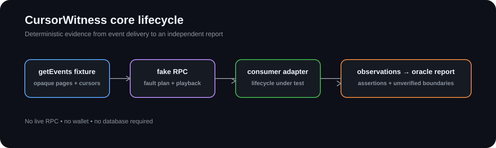

# CursorWitness Core

[](https://github.com/CursorWitness/cursorwitness-core/actions/workflows/ci.yml)
[](LICENSE)
[](https://nodejs.org/)



The transport-neutral reliability engine for [CursorWitness](https://github.com/CursorWitness).

CursorWitness tests the lifecycle between Stellar RPC event delivery and an application's observable state. The core package provides the contracts, deterministic fixtures, lifecycle observations, independent oracle, scenarios, and versioned semantic reports used by the CLI and adapters.

## Repository role

```text
Stellar getEvents fixture
          │
          ▼
  fake RPC + fault plan ──► consumer adapter
          │                       │
          └──── observations ◄────┘
                    │
                    ▼
          independent oracle/report
```

This repository owns provider-neutral behavior. It does not contain a live RPC client, wallet handling, database, hosted service, or application-specific consumer integration.

## What it validates

- continuation across empty and non-empty pages;
- opaque cursor propagation;
- application-defined checkpoints;
- delivery, handler invocation, attempted effects, committed effects, and checkpoint persistence as separate observations;
- deterministic crash and restart boundaries;
- duplicate delivery versus duplicate durable business effect;
- retention and transport-error classification;
- semantic report determinism.

The oracle reports `unverified` when an adapter cannot expose a boundary. In-memory state is treated as a test double, not proof of database durability. CursorWitness does not promise exactly-once processing or universal application correctness.

## Quick start

Requirements: Node.js 20.19+ and pnpm 10.12+.

```bash
pnpm install --frozen-lockfile
pnpm run verify
```

Useful commands:

```bash
pnpm run typecheck
pnpm test
pnpm run package:check
```

## Documentation map

- [`schemas/`](schemas/) — versioned fixture and report schemas
- [`src/`](src/) — core contracts and execution primitives
- [`test/`](test/) — unit and scenario-level contract tests
- [`CONTRIBUTING.md`](CONTRIBUTING.md) — contribution workflow
- [`SECURITY.md`](SECURITY.md) — security boundaries and reporting

## Project status

This repository is an implementation seam for the CursorWitness v0.1.0 development line. The package is not published to npm; downstream repositories pin this repository by Git commit while the public API stabilizes.

## Related repositories

- [`cursorwitness-cli`](https://github.com/CursorWitness/cursorwitness-cli) — offline executable and report presentation
- [`cursorwitness-adapters`](https://github.com/CursorWitness/cursorwitness-adapters) — consumer-specific integration seams

## License

Apache-2.0. See [`LICENSE`](LICENSE).
